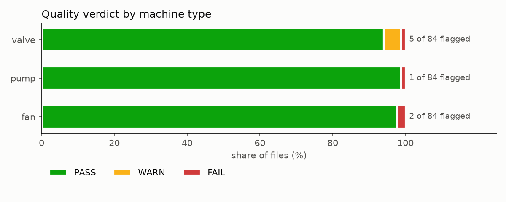
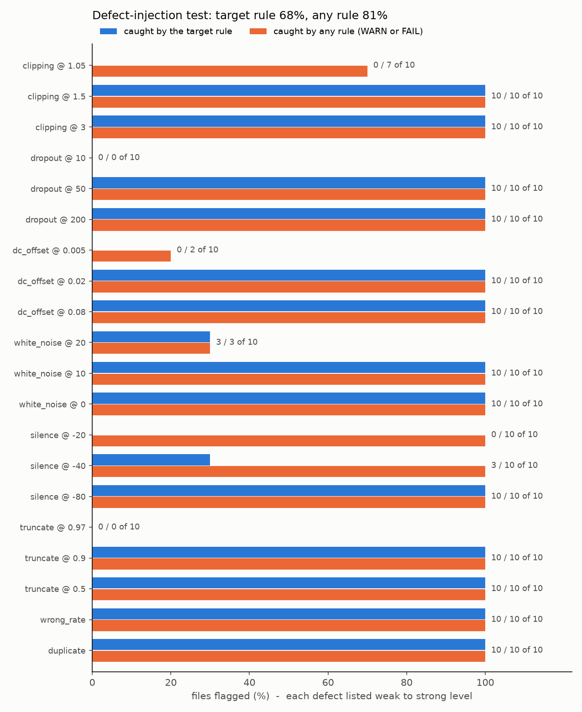

# 물리 데이터 품질 점검 실습 (physical-data-quality-lab)

**기기음(물리 데이터) 품질 점검 자동화 + 온톨로지 + LLM 보고서** 실습 저장소입니다.

제조 피지컬 AI는 센서가 실제로 잰 신호로 학습합니다. 그래서 학습 전에 "이 데이터를 믿고 써도 되는가"를 시험해야 합니다.
이 저장소는 그 과정을 처음부터 끝까지 작게 구현합니다.

1. **품질 지표 계산**: 파일마다 클리핑, 끊김, DC 오프셋, 무음, 추정 SNR, 스펙트럼 평탄도 등을 잽니다.
2. **규칙 기반 판정**: 기준값과 비교해 PASS / WARN / FAIL을 정합니다. 중복 파일과 통계적 이상치도 찾습니다.
3. **결함 주입 시험**: 깨끗한 파일에 알고 있는 결함을 세기별로 넣어, 점검기가 어디까지 잡는지(검출 한계) 시험합니다.
4. **온톨로지**: 결과를 W3C 표준 어휘(SOSA, DQV)로 지식그래프(RDF)에 담고 SPARQL로 질의합니다.
5. **LLM 보고서**: 코드가 만든 요약만 LLM에 주어 보고서 초안을 쓰게 하고, 보고서의 숫자를 코드로 대조합니다.
6. **LLM 메타데이터 정리**: 기업마다 제각각인 데이터 설명서를 LLM이 표준 항목으로 정리 → 코드가 형식 검사·실제 데이터와 대조 → 온톨로지 확장(v0.2).
7. **LLM 질의 번역**: 말로 한 질문을 LLM이 SPARQL로 번역 → 온톨로지가 답을 냄 → 정답 질의와 결과 비교로 정확도 측정.

> 원칙: **숫자 계산과 판정은 코드가, 해석과 문장은 LLM이, 최종 승인은 사람이** 합니다.

## 처리 흐름

```
WAV 파일들
  │ 01_check_quality.py      지표 계산 + 규칙 판정  → metrics.csv, issues.csv
  │ 02_inject_and_validate.py 결함 주입 → 검출률     → injection_summary.csv
  │ 03_build_ontology.py     RDF 지식그래프 생성     → quality_graph.ttl
  │ 04_query_ontology.py     SPARQL 질의             → ontology_queries.md
  │ 05_llm_report.py         LLM 보고서 + 숫자 대조  → quality_report.md
  │ 06_llm_metadata.py       설명서 → 메타데이터 → 온톨로지 → metadata_eval.csv, metadata_graph.ttl
  └ 07_llm_ask.py            질문 → SPARQL → 정확도  → ask_eval.csv, ask_log.md
```

## 빠른 실행 (데모 데이터, 약 1분)

```bash
pip install -r requirements.txt
python run_all.py          # 데모 데이터 생성부터 보고서까지
```

DCASE Task 2처럼 생긴 합성 기기음(fan, pump, valve 252개)을 만들고, 일부러 심어 둔 결함 4개를 찾아냅니다.

## DCASE 2026 Task 2 데이터에 적용

```bash
python run_all.py --data <DCASE dev_data 폴더> --out results_dcase

# 또는 한 단계씩:
python scripts/01_check_quality.py --data <DCASE dev_data 폴더> --out results_dcase
python scripts/02_inject_and_validate.py --data <DCASE dev_data 폴더> --results results_dcase
python scripts/03_build_ontology.py --results results_dcase
python scripts/04_query_ontology.py --results results_dcase
python scripts/05_llm_report.py --results results_dcase
```

폴더 구조 `<기기>/<train|test>/section_00_<source|target>_<train|test>_<normal|anomaly>_xxxx_*.wav` 를 자동으로 읽습니다.

## 데모 결과

**1) 심어 둔 결함 4개를 모두 FAIL로 찾음** (252개 중 PASS 244, WARN 4, FAIL 4)

| 파일 | 규칙 | 근거 |
|---|---|---|
| fan …train_normal_0003 | 클리핑 | 클리핑 비율 0.6157 > 0.01 |
| pump …train_normal_0005 | 끊김 | 정지 구간 300 ms > 100 ms |
| valve …test_normal_0002 | 중복 | 0001과 내용 동일 (MD5) |
| fan …test_normal_0007 | 샘플링레이트 | 8000 Hz ≠ 16000 Hz |



**2) 결함 주입 시험: 기준값보다 약한 결함은 설계상 놓친다**

8종 결함을 세기별(약/중/강)로 10개씩, 200개를 주입했습니다. 그 결함을 잡도록 만든 규칙(목표 규칙, target rule)이 잡은 비율은 68%, 어떤 규칙이든 WARN/FAIL을 낸 비율(전체 규칙, any rule)은 81%입니다.
강한 결함은 모두 잡았지만, 기준값 아래의 약한 결함(10 ms 끊김, 길이 3% 부족 등)은 놓쳤습니다.
**즉 기준값을 정하는 일이 곧 품질 정책**입니다. 절대 기준이 놓친 일부 결함은 "같은 기기 대비 통계적 이상치" 규칙이 보완했습니다.



**3) 통계적 이상치 경고 9건 중 4건은 '이상(anomaly)' 라벨 파일**

통계적으로 튀는 파일이 모두 데이터 결함은 아닙니다. 실제 고장음일 수 있으므로 자동으로 지우면 안 되고, 사람이 구분해야 합니다.

**4) 온톨로지 질의 예** ([전체 결과](results/ontology_queries.md))

"품질 차원별 이슈 수는?" 같은 질문에 규칙 → 지표 → 품질 차원(완전성·정확성·일관성·유일성) 관계를 따라가 답합니다.

## 온톨로지 설계

| 이 저장소의 개념 | 표준 어휘 |
|---|---|
| 기계 `pdq:Machine` | `sosa:FeatureOfInterest` 의 하위 클래스 |
| 마이크 `pdq:Microphone` | `sosa:Sensor` 의 하위 클래스 |
| 녹음 파일 `pdq:AudioRecording` | `sosa:Observation` 의 하위 클래스 |
| 품질 측정값 | `dqv:QualityMeasurement` (`dqv:computedOn`, `dqv:value`) |
| 품질 지표 / 차원 | `dqv:Metric` / `dqv:Dimension` |
| 품질 규칙, 이슈 | `pdq:QualityRule`, `pdq:QualityIssue` |

스키마는 [`ontology/pdq_schema.ttl`](ontology/pdq_schema.ttl) 이며 Protégé로 열어 볼 수 있습니다.

**v0.2 변경**
- SOSA 표준에 맞게 수정: `센서 sosa:observes 기계` → `센서 sosa:observes pdq:sound`(관측 속성) + `센서 pdq:monitors 기계`
- 확장 스키마 [`ontology/pdq_extension.ttl`](ontology/pdq_extension.ttl): 기계 종류 계층(회전 기계 등), 센서 종류(가속도계·전류·온도),
  관측 속성(진동·전류·온도), 데이터셋(`dcat:Dataset`)

## LLM 연결 방법 (`--provider`)

| 방식 | 비용 | 준비 | 특징 |
|---|---|---|---|
| `manual` | 무료 | 없음 | 질문 파일(`llm_io/*_prompt.txt`)을 Claude 채팅 등에 붙여넣고, 답을 `*_response.txt` 로 저장 후 재실행 |
| `ollama` | 무료 | [Ollama](https://ollama.com) 설치 + `ollama pull qwen2.5:7b` | **내 PC 안에서 실행 → 데이터가 외부로 나가지 않음** (시험기관 보안에 적합) |
| `anthropic` / `openai` | 유료 | API 키 환경변수 | 가장 정확, 대량 처리 |

```bash
python scripts/06_llm_metadata.py --provider manual
python scripts/07_llm_ask.py --provider ollama --answer
python scripts/07_llm_ask.py --provider ollama --q "valve 기계에서 WARN 판정 파일은 몇 개야?"
```

## LLM 기능의 검증 방법

| 기능 | LLM이 하는 일 | 코드가 검증하는 일 | 정답 |
|---|---|---|---|
| 05 보고서 | 요약을 문장으로 | 보고서 숫자를 요약과 대조 | - |
| 06 메타데이터 | 설명서 12개 → JSON | 형식 검사(허용값·범위), 실제 측정값과 대조 | `examples/metadata/ground_truth.json` |
| 07 질의 번역 | 질문 10개 → SPARQL | 안전 검사(SELECT만), 실행 결과를 정답 질의 결과와 비교 | `examples/questions.json` |

06은 LLM 없이 키워드·정규식만 쓰는 추출기와 정확도를 비교합니다 (데모: 규칙 81.9%).

## LLM 보고서와 환각 방지

- LLM에는 원본 오디오가 아니라 **집계된 요약(JSON)만** 보냅니다.
- 프롬프트로 "요약에 없는 숫자 금지, 판정 변경 금지, 원인은 '추정'으로 표시"를 지시합니다.
- 보고서의 숫자를 모두 뽑아 **요약과 코드로 대조**하고, 없는 숫자는 "확인 필요"로 표시합니다.
- `--provider` 를 주지 않으면 API 키 → 내 PC의 Ollama 순서로 찾고, 없으면 템플릿 보고서를 씁니다.
  모델 이름은 `PDQ_LLM_MODEL` 환경변수로 바꿉니다.

## 한계와 다음 단계

- 기준값(`config/thresholds.json`)은 예시입니다. 센서와 용도에 맞춰 전문가가 정해야 합니다.
- 추정 SNR은 프레임 에너지 비율로 계산한 **비교용 지표**입니다. 정상(stationary) 기계음에서는 절대값 의미가 약합니다.
- 다음 단계: 진동·전류 등 다른 센서로 확장, 품질 결함이 이상탐지 성능(AUC)에 미치는 영향 측정,
  설비 정보 표준(AAS)과 연결.

## 관련 저장소

- [machine-sound-anomaly-detection](https://github.com/qripapa01/machine-sound-anomaly-detection): 오토인코더 기반 기기음 이상탐지 (DCASE 2026 Task 2)

## 참고

- W3C SOSA/SSN (센서·관측 어휘): https://www.w3.org/TR/vocab-ssn/
- W3C DQV (데이터 품질 어휘): https://www.w3.org/TR/vocab-dqv/
- ISO/IEC 5259 (AI·분석용 데이터 품질), NIA 인공지능 학습용 데이터 품질관리 가이드라인
